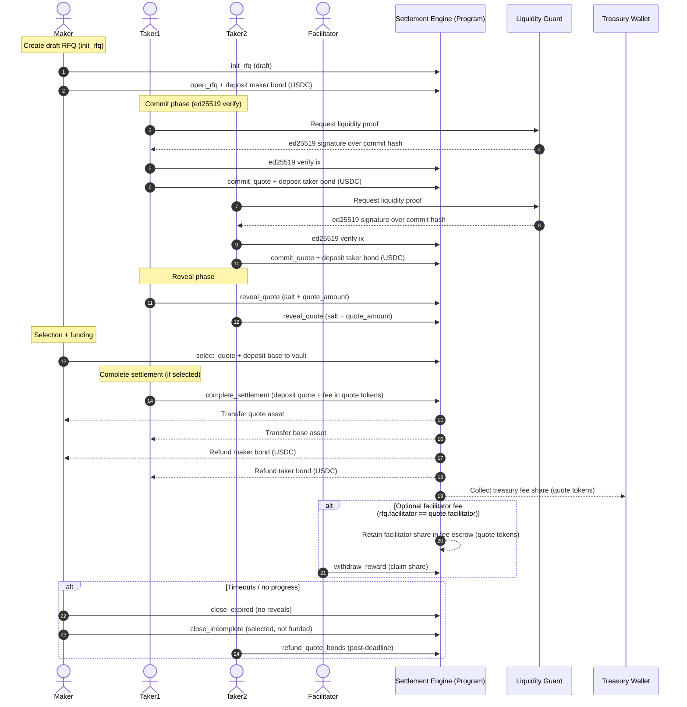

# 🧩 UnleakTrade Settlement Engine

**UnleakTrade Settlement Engine** is the core **on-chain Solana program** for OTC (Over-The-Counter) RFQ trading between makers and takers.  
It enforces trustless settlement, manages USDC bonds and quote-token fees, and encodes the entire **RFQ lifecycle** into verifiable, stateful Solana accounts.

| | |
|---|---|
| Program ID | `7wrjbU1NbVtUCUGP1obi3aiT6QrjXZnH5XJDXMsKtkPG` (localnet and devnet, see `Anchor.toml`) |
| Mainnet | Not deployed yet (no `[programs.mainnet]` entry) |
| Toolchain | Rust 1.89.0 (`rust-toolchain.toml`), Anchor 0.32.1 (CLI pinned in `Anchor.toml`), Node 20 in CI, yarn |

---

## ⚙️ Architecture

### 🧱 Accounts & PDAs

- **Config**
  - Global singleton: admin, USDC mint, treasury wallet, liquidity guard pubkey (ed25519), facilitator fee bps.
  - PDA: `["config"]`
- **RFQ**
  - One per OTC request, uniquely identified by `(maker, uuid)`.
  - PDA: `["rfq", maker, uuid]`
  - Holds assets, economics, TTLs, state, and references to vaults/accounts.
- **Quote**
  - One per `(rfq, taker)` for commit/reveal lifecycle.
  - PDA: `["quote", rfq, taker]`
- **CommitGuard**
  - Prevents commit hash reuse globally.
  - PDA: `["commit-guard", commit_hash]`
- **Settlement**
  - Snapshot created at selection (amounts, mints, vaults, participants); the economic terms are fixed from then on.
  - `complete_settlement` fills in the completion fields (`completed_at`, `taker_funded_at`, taker token accounts); `close_incomplete` closes the account.
  - PDA: `["settlement", rfq]`
- **SlashedBondsTracker**
  - Tracks bond seizures into treasury for a given RFQ.
  - PDA: `["slashed_bonds_tracker", rfq]`
- **FeesTracker**
  - Records taker fee paid to treasury (in quote tokens).
  - PDA: `["fees_tracker", rfq]`
- **FacilitatorRewardTracker**
  - Records facilitator fee claim (when applicable).
  - PDA: `["facilitator_reward", rfq, facilitator]`

Token accounts owned by the RFQ PDA:

- `bonds_escrow`: USDC ATA holding the maker and taker bonds.
- `vault_base_ata`: base-mint ATA holding the maker's base asset from `select_quote` until settlement.
- `fee_escrow`: quote-mint ATA holding the facilitator share until `withdraw_reward`.

---

## 🛠️ Managing Config

`Config` is the **single most important account** in the deployment — it is the
global singleton (PDA `["config"]`) that RFQ creation reads. There is
exactly one per program deployment, owned by `admin`.

Each RFQ **snapshots** `usdc_mint`, `treasury_wallet`, `liquidity_guard` and
`facilitator_fee_bps` at `init_rfq`, and later instructions use that snapshot
(for example `commit_quote` checks the guard key stored on the RFQ). An
`update_config` therefore only affects RFQs created afterwards.

| Field | Type | Meaning |
|-------|------|---------|
| `admin` | `Pubkey` | Admin authority — the only signer allowed to update/close Config |
| `usdcMint` | `Pubkey` | USDC mint used for fees/bonds |
| `treasuryWallet` | `Pubkey` | Treasury wallet; its ATAs receive protocol fees (quote tokens) and slashed bonds (USDC) |
| `liquidityGuard` | `Pubkey` | ed25519 public key of the liquidity-guard service |
| `facilitatorFeeBps` | `u16` | Facilitator fee in basis points (1 BPS = 0.01%), **0..10000** |

There are three scripts, all cluster-agnostic. The target cluster comes from
`ANCHOR_PROVIDER_URL` — a full RPC URL **or** a short, case-insensitive alias
(`devnet`, `testnet`, `mainnet` / `mainnet-beta`, `localnet` / `localhost`) —
and **defaults to devnet** when unset. They load the program from `target/`,
so run `yarn install` and `anchor build` first. The same scripts are exposed as
`anchor run init-config-devnet | update-config | get-config`.

### 1. Initialise (once per cluster) — `scripts/init-config-devnet.ts`

Creates the Config account. Idempotent (exits if it already exists). Inputs via
env vars; the `ANCHOR_WALLET` keypair becomes `Config.admin`:

```bash
ANCHOR_PROVIDER_URL=https://api.devnet.solana.com \
ANCHOR_WALLET=~/.config/solana/id.json \
LIQUIDITY_GUARD=<ed25519 service pubkey> \
USDC_MINT=4zMMC9srt5Ri5X14GAgXhaHii3GnPAEERYPJgZJDncDU \
TREASURY_WALLET=<pubkey> \
FACILITATOR_FEE_BPS=1000 \
yarn init-config
```

- `LIQUIDITY_GUARD` is **required**: the guard's ed25519 `service_pubkey` (from its `/health`).
- `USDC_MINT` defaults to the devnet USDC mint above **on every cluster**, so set it explicitly anywhere else.
- `TREASURY_WALLET` defaults to the admin pubkey (a warning is printed).
- `FACILITATOR_FEE_BPS` is optional; the program default is `1000` (10%).

### 2. Update any field(s) — `scripts/update-config.ts`

Drives the on-chain `update_config` instruction, which updates **any subset** of
fields in one transaction; fields you don't pass are left untouched. Values come
from a **JSON or YAML file**, **CLI flags**, or both (**flags override the file**).

> ⚠️ The signing wallet (`ANCHOR_WALLET`) **must be the current `Config.admin`**,
> otherwise the transaction fails with `Unauthorized`.

**a) CLI flags only**

```bash
ANCHOR_PROVIDER_URL=https://api.devnet.solana.com \
ANCHOR_WALLET=~/.config/solana/id.json \
yarn update-config --facilitator-fee-bps 1500
```

**b) From a JSON / YAML file** (parsed by extension; both camelCase and
snake_case keys accepted). Copy `scripts/config.example.yaml` (or `.json`) and
edit only the fields you want to change:

```bash
yarn update-config --config scripts/config.example.yaml
```

```yaml
# scripts/config.example.yaml — every key is optional
facilitatorFeeBps: 1500
# treasuryWallet: "TreasuryPubkeyBase58Here..."
# liquidityGuard: "5gfPFweV3zJovznZqBra3rv5tWJ5EHVzQY1PqvNA4HGg"
```

> ⚠️ The `liquidityGuard` value in the example file is the key of the
> **test-only** `SKIP_FUND_CHECKS` guard instance used by `anchor test`. Never
> set it on a real Config: use the `service_pubkey` of the balance-checking
> guard for that cluster.

**c) File for the base, flags to override individual fields**

```bash
yarn update-config --config scripts/config.example.yaml --treasury-wallet <pubkey>
```

**Available flags**

```
--config <path>            JSON (.json) or YAML (.yaml/.yml) file of fields
--admin <pubkey>           rotate admin authority (ONE-WAY handoff!)
--usdc-mint <pubkey>
--treasury-wallet <pubkey>
--liquidity-guard <pubkey>
--facilitator-fee-bps <n>  integer 0..10000
--dry-run                  print the planned before → after diff, send no tx
--help                     show usage
```

The script prints a **before → after diff**, skips values that already match
on-chain (so the tx never carries no-op writes), warns loudly on **admin
rotation**, and supports `--dry-run` to preview changes safely:

```bash
yarn update-config --config scripts/config.example.yaml --dry-run
```

### 3. View the current Config — `scripts/get-config.ts`

Read-only: fetches and displays the Config account. No `ANCHOR_WALLET` needed (no
transaction is sent — an ephemeral wallet is used), and the cluster defaults to
devnet.

```bash
# Human-readable summary (PDA, cluster, fields, fee as %) — defaults to devnet
yarn get-config

# Target another cluster (alias or full URL)
ANCHOR_PROVIDER_URL=localnet yarn get-config

# Machine-readable JSON only (pipeable); prints `null` if not initialised
yarn get-config --json
```

---

## 🔄 RFQ Lifecycle

Each RFQ passes through the following **states**. Nothing is automatic: every transition is an instruction someone submits. The commit, reveal and selection deadlines are cumulative from `opened_at`; the funding deadline is described below.

| Phase | Description | State |
|-------|--------------|-------|
| Init | Maker creates a draft RFQ (bond amount, TTLs, base/quote tokens) | `Draft` |
| Publish | Maker opens RFQ to takers | `Open` |
| Commit | Takers commit hashed quotes | `Committed` |
| Reveal | Takers reveal quotes for validation | `Revealed` |
| Select | Maker selects the winning quote and deposits base | `Selected` |
| Settle | Taker deposits quote + fee; swap and refunds execute | `Settled` |
| Timeout | RFQ exceeds a deadline without completion | `Expired` / `Ignored` / `Incomplete` |

Terminal timeout states and the instruction that records each:

| State | Meaning | Recorded by |
|-------|---------|-------------|
| `Expired` | No commit, or no quote revealed | `close_expired` (maker, after the reveal deadline, from `Open` or `Committed`) |
| `Ignored` | Quotes were revealed but the maker never selected | the first `refund_quote_bonds` (a taker, after the funding deadline, from `Revealed`); there is no dedicated close instruction |
| `Incomplete` | A quote was selected but the taker never funded | `close_incomplete` (maker, after the funding deadline, from `Selected`) |

Phase windows:
- `commit_quote`: until the commit deadline.
- `reveal_quote`: only after the commit deadline, until the reveal deadline.
- `select_quote`: only after the reveal deadline, until the selection deadline.
- `complete_settlement`: until the funding deadline.

Funding deadline behavior:
- If a quote is selected: funding deadline = `selected_at + fund_ttl_secs`.
- If no selection yet: funding deadline = `opened_at + commit + reveal + selection + fund`.

---

## 🔐 Liquidity Guard Commit/Reveal

Commit phase requires a Liquidity Guard **ed25519 signature** on the 32-byte commit hash.  
The on-chain program verifies that the immediately preceding instruction in the same transaction is a native ed25519 verify ix, carrying exactly one signature over a 32-byte message, signed by the Liquidity Guard public key snapshotted on the RFQ at `init_rfq`.

The commit hash is recomputed on reveal as:

```
hash(
  salt (64 bytes) ||
  rfq_pubkey ||
  taker_pubkey ||
  quote_mint ||
  quote_amount (u64 LE) ||
  bond_amount (u64 LE) ||
  taker_fee_bps (u16 LE)
)
```

`hash` is SHA-256 over those 178 bytes. The `salt` is the taker's ed25519 signature over the RFQ pubkey bytes (the Liquidity Guard rejects anything else), so the taker can always re-derive it.

Reveals must meet `min_quote_amount` and match the stored commit hash; a mismatch fails with `Unauthorized`.

---

## ↔️ Sequence Diagram (Current Flow)



## 💰 Bonds, Fees, and Slashing

### Bonds (USDC)
- Maker and each taker post a **USDC bond** into the RFQ-owned `bonds_escrow`.
- Maker and taker bonds are the same per-RFQ `bond_amount`.
- On successful settlement, the maker's and the selected taker's bonds are refunded by `complete_settlement`.
- Takers who revealed but were not selected reclaim their bond with `refund_quote_bonds` once the funding deadline has passed.
- The maker's bond is also refunded on `Expired` and `Incomplete`.
- Slashed bonds are sent **entirely to the treasury** in USDC: every committed quote that was never revealed, the selected taker's bond if they do not fund (`Incomplete`), and the maker's bond if they never select a revealed quote (`Ignored`).

### Fees (Quote tokens)
- Takers pay a protocol fee **in quote tokens** on settlement.
- Fee formula: `floor(quote_amount * taker_fee_bps / 10_000)`, with a minimum of **1** when `taker_fee_bps > 0` (the protocol is never free).
- Treasury receives the fee minus any facilitator share.
- If `rfq.facilitator` matches `quote.facilitator`, the facilitator share (`floor(total_fee * facilitator_fee_bps / 10_000)`) is retained in a quote-token fee escrow and can be claimed via `withdraw_reward`.
- The fee formula must match the **liquidity-guard** implementation exactly to prevent preflight/on-chain mismatches.

---

## 🔗 Liquidity Guard Integration

The **Liquidity Guard** acts as an off-chain validator:

- Verifies **liquidity and solvency** of takers before commit.
- Produces an ed25519 signature over the commit hash.
- The program enforces that signature using the native ed25519 verify instruction.

Together, Liquidity Guard + Settlement Engine form a **hybrid trust-minimized OTC system**:  
off-chain verification with on-chain enforcement.

---

## 🧠 Program Design Highlights

- **Anchor framework** 0.32.1 (see `programs/settlement-engine/Cargo.toml`; CLI version pinned in `Anchor.toml`)
- **UUID-based RFQ PDAs** (multi-RFQ support per maker)
- **Strict state machine** enforced via enum transitions
- **Commit-reveal** with Liquidity Guard ed25519 verification
- **On-chain bond and fee accounting** via SPL Token + ATA programs
- **Facilitator fee support** with on-chain reward claims

---

## 📜 Instructions

17 instructions (`programs/settlement-engine/src/lib.rs`). Error codes are in `programs/settlement-engine/src/rfq_errors.rs`; the program emits no events.

| Instruction | Signer | Allowed when | Effect |
|-------------|--------|--------------|--------|
| `init_config` | admin | Config does not exist | Creates Config |
| `update_config` | admin | — | Updates any subset of Config fields |
| `close_config` | admin | — | Closes Config, rent to admin |
| `init_rfq` | maker | — | Creates the RFQ in `Draft`, snapshots Config |
| `update_rfq` | maker | `Draft` | Edits the draft |
| `cancel_rfq` | maker | `Draft` | Closes the RFQ account |
| `open_rfq` | maker | `Draft` | Deposits the maker bond, → `Open` |
| `set_rfq_facilitator` | maker | `Draft` to `Revealed` | Sets the RFQ facilitator |
| `commit_quote` | taker | `Open` / `Committed`, before the commit deadline | Deposits the taker bond, stores the commit hash, → `Committed` |
| `set_quote_facilitator` | taker | `Draft` to `Selected` | Sets the quote facilitator |
| `reveal_quote` | taker | `Committed` / `Revealed`, reveal window | Reveals salt and amount, → `Revealed` |
| `select_quote` | maker | `Revealed`, selection window | Locks the base asset, creates Settlement, → `Selected` |
| `complete_settlement` | selected taker | `Selected`, before the funding deadline | Swap, fees, bond refunds, → `Settled` |
| `close_expired` | maker | `Open` / `Committed`, no quote revealed, after the reveal deadline | Refunds the maker bond, slashes unrevealed bonds, → `Expired` |
| `close_incomplete` | maker | `Selected`, after the funding deadline | Returns the base asset and maker bond, slashes the selected taker, → `Incomplete` |
| `refund_quote_bonds` | taker (revealed, not selected) | `Revealed` or later, after the funding deadline | Refunds that taker's bond; on a `Revealed` RFQ it also slashes the maker bond and unrevealed bonds, → `Ignored` |
| `withdraw_reward` | facilitator | `Settled` | Claims the facilitator share from the fee escrow |

---

## 🧰 Getting Started

```bash
yarn install

# Build the program (also generates target/types, needed by scripts and tests)
anchor build

# Unit tests only (no validator, no network)
yarn test:unit

# Full suite on a local validator
anchor test

# Formatting check, as CI runs it (prettier on scripts and unit tests)
npx prettier "scripts/**/*.ts" "tests/unit/**/*.ts" --check
```

`yarn lint` / `yarn lint:fix` run prettier over the whole tree, which currently reports the integration test files as unformatted; CI only gates the narrower command above.

`anchor test` runs everything under `tests/` (integration and unit) and needs outbound network access to the Liquidity Guard. CI (`.github/workflows/ci.yml`) runs two jobs: a prettier check plus the unit tests, and the anchor tests.

The integration tests call a live Liquidity Guard (`POST /check`) to obtain commit attestations (helpers in `tests/utils/liquidityGuard.ts`):

| Env var | Purpose |
| --- | --- |
| `LIQUIDITY_GUARD_URL` | Guard base URL (default: the devnet `SKIP_FUND_CHECKS` instance) |
| `LIQUIDITY_GUARD_API_KEY` | Sent as `X-API-Key` on `/check` when the guard runs with `API_KEYS`; unset = no header. CI reads it from the `LIQUIDITY_GUARD_API_KEY` repository secret |

### 🧱 SBF stack guard

Every SBF function runs in a fixed **4 KiB stack frame**. Anchor generates one `try_accounts` function per instruction that deserializes and validates *all* of its accounts, so large `Accounts` structs sit close to that limit. When a function needs more, LLVM prints

```
Error: Function <…> Stack offset of 4104 exceeded max offset of 4096 by 8 bytes, please minimize large stack variables.
Estimated function frame size: 4160 bytes. Exceeding the maximum stack offset may cause undefined behavior during execution.
```

**but `anchor build` / `cargo build-sbf` still succeed and emit a `.so`.** Deploying it means silent memory corruption at runtime. `scripts/sbf-stack.ts` turns that diagnostic into a hard failure and reports how close each instruction is to the limit:

```bash
# Fail (exit 1) if the build printed a stack overflow (exit 2 if the program crate was not recompiled)
cargo build-sbf --manifest-path programs/settlement-engine/Cargo.toml 2>&1 | tee sbf-build.log
yarn sbf-stack check sbf-build.log

# Approximate frame usage per try_accounts / handler / dispatch function (needs the unstripped .so)
yarn sbf-stack report target/sbpf-solana-solana/release/settlement_engine.so
```

CI runs both in the `SBF stack guard` job: the check fails the PR, and the report is published in the job summary with a warning for anything at or above 90% of the frame.

If a change trips the guard: `Box<Account<'info, T>>` the accounts of that instruction, move rarely-needed accounts out of the `Accounts` struct, or split the instruction.
